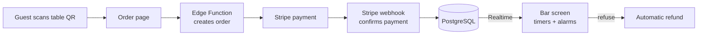

# QR order-and-pay platform

**Scan, order and pay at the table. The order lands on the bar screen in seconds.**

- Live card payments with automatic refunds
- Real-time bar screen with escalating alarms
- Rebuilt and hardened for a second venue

> Source is private (live client system). **[Full write-up →](https://sajjad.omni-genai.com/projects/qr-order-and-pay)**

`PostgreSQL` · `Supabase` · `Edge Functions` · `Realtime` · `Stripe` · `Netlify Functions` · `bcrypt`

<b>How an order flows</b>

<b>What I built</b>

- **Database from scratch:** orders, items, catalogue, locations, settings, refunds and an audit trail. Every table and room has an unguessable token.
- **Live Stripe payments:** webhook reconciliation across four event types, and three Edge Functions for order creation, webhooks and refunds.
- **Real-time bar screen:** per-order timers, a chime at two minutes that escalates at four and six to a full-screen alarm, refuse-with-reason and a live sold-out toggle. Refuse-and-refund is proven in live service.
- **Allergen safety:** the database won't let a dish go live without allergen text.
- **Admin console:** pricing, menu toggles, service hours and printable QR table cards.

<b>Hardened rebuild for a second venue (Oct 2026)</b>

- **No database key in any page.** Pages only talk to the site's own `/api/`, which forwards to server functions.
- **Locked tables.** Row-level security on, no policies, public grants revoked.
- **Server-side money checks.** Prices calculated on the server, webhook signatures verified, replays refused, and refunds never more than taken or twice.
- **Staff access.** bcrypt-hashed passcodes, 16-hour bar and 4-hour manager sessions, and lockouts after 8 wrong tries.
- **Tested before launch.** 49 automated attack checks; 48 passed. The one failure was a mistake in the test, not the code.

<b>What went wrong on the way</b>

- Closed an enumeration risk before launch with a lookup that returns at most one row.
- Fixed a gateway-level CORS rejection that blocked every guest request.
- Traced a payment failure to a mangled key value by reading the raw error.

---

Built by **[Sajjad Mahessar](https://sajjad.omni-genai.com)** · [LinkedIn](https://www.linkedin.com/in/sajjadmahessar/)
